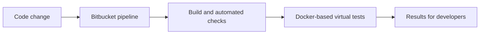
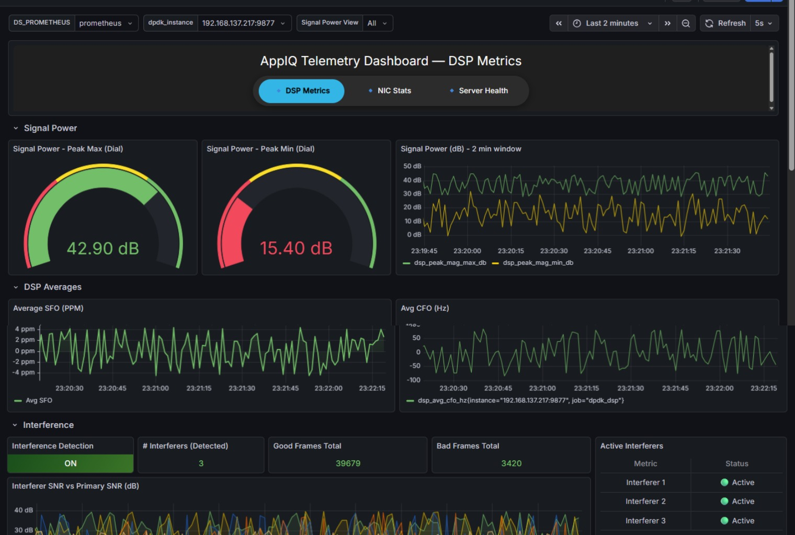

# Md. Shahariar Hassan Ronok

**Embedded Software Engineer · Linux · Docker · CI/CD · Observability**

I build reproducible test environments, automate validation pipelines, and develop containerized services for Linux-based systems.

---

### Working Stack

  

**Professional:** Docker · Bitbucket Pipelines · Linux · C/Python · gRPC · Prometheus · Grafana  
**Independent labs:** Jenkins · GCP · Nginx · HTTPS/TLS · VPS deployment

---

### What I've Built

| Professional project | My contribution | Details |
|---|---|---|
| **Docker-based CI/CD testing** | Built the containerized test environment and configured Bitbucket pipelines and automated checks; used by ~5 developers | [Case study](https://github.com/ronok-shahariar/ronok-devops-portfolio/tree/main/src/app/projects/hardware-independent-dpdk-testing) |
| **Containerized observability** | Developed Python metrics exporter, Docker services, and Prometheus/Grafana integration | [Case study](https://github.com/ronok-shahariar/ronok-devops-portfolio/tree/main/src/app/projects/containerized-observability) |
| **C/Python service integration** | Designed and implemented shared-memory-to-gRPC data delivery components | [Case study](https://github.com/ronok-shahariar/ronok-devops-portfolio/tree/main/src/app/projects/dpdk-grpc-data-pipeline) |
| **Secure software licensing** | Architected runtime authorization, signed license validation, integrity checks, and audit logging | [Case study](https://github.com/ronok-shahariar/ronok-devops-portfolio/tree/main/src/app/projects/secure-software-licensing) |

### CI/CD Workflow — Architecture Overview

Conceptual workflow of my professional testing solution, not a screenshot of a production pipeline.

### Monitoring — Actual Dashboard

  

**Python exporter → Prometheus → Grafana** · Containerized telemetry and monitoring services.

Dashboard image should be shared only with employer permission; identifying operational details must be removed before publication.

---

**[Explore DevOps case studies and engineering demos](https://github.com/ronok-shahariar/ronok-devops-portfolio)** · **[Software projects](https://porfolio-ronok.vercel.app/)**

*Professional source code and deployment configurations are private; case studies describe my own contributions without disclosing proprietary implementation details.*

